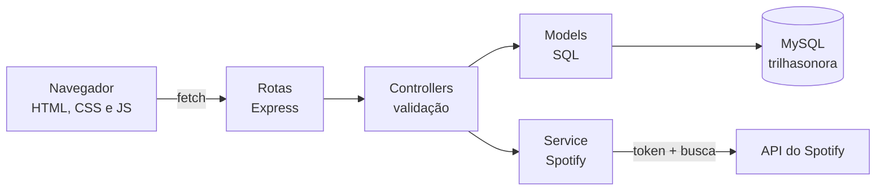
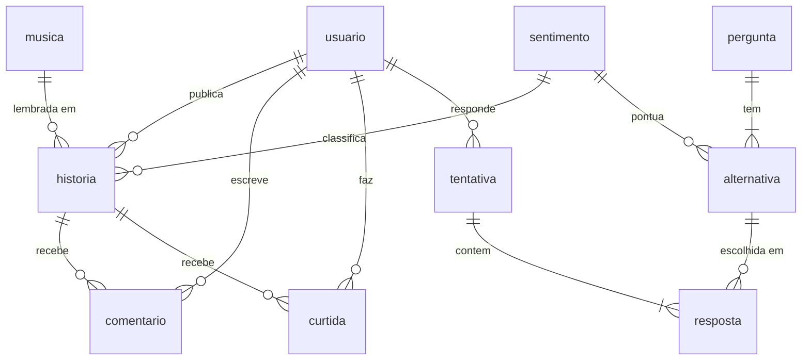

# 🎵 Além do Som

> **Toda música guarda uma história.**


O **Além do Som** é uma comunidade e um fórum para guardar memórias musicais. Cada pessoa escolhe uma música, conta qual sentimento ela desperta e qual lembrança carrega. Reunidas, essas histórias mostram o que a música faz com a gente e ajudam quem lê a perceber que não sente sozinho.

O projeto nasceu de duas observações: os aplicativos de música tratam cada canção como número, ranking e algoritmo, esquecendo o valor sentimental de cada faixa; e, mesmo hiperconectadas, muitas pessoas têm dificuldade de falar sobre o que sentem. Aqui, a música funciona como ponte entre quem compartilha as mesmas dores, alegrias e nostalgias.

Projeto individual de **Pesquisa e Inovação** da **São Paulo Tech School** (Ciência da Computação, 1º semestre), sobre *como a música dá forma aos nossos sentimentos mais profundos e reabre as portas das nossas lembranças*.

---

## 📑 Sumário

1. [Funcionalidades](#-funcionalidades)
2. [Telas](#-telas)
3. [Arquitetura](#-arquitetura)
4. [Tecnologias](#-tecnologias)
5. [Estrutura de pastas](#-estrutura-de-pastas)
6. [Banco de dados](#-banco-de-dados)
7. [Como executar](#-como-executar)
8. [Configurando o Spotify](#-configurando-o-spotify)
9. [Documentação da API](#-documentação-da-api)
10. [Questionário e dashboard](#-questionário-e-dashboard)
11. [Segurança](#-segurança)
12. [Solução de problemas](#-solução-de-problemas)
13. [Identidade visual](#-identidade-visual)
14. [Conceitos aplicados](#-conceitos-aplicados)
15. [Status e próximos passos](#-status-e-próximos-passos)
16. [Limitações conhecidas](#-limitações-conhecidas)
17. [Direitos de imagem](#-direitos-de-imagem)
18. [Autoria e licença](#-autoria-e-licença)

---

## ✨ Funcionalidades

- **Home acolhedora:** abertura com um vinil, o texto **Sobre o projeto** (o porquê da plataforma), histórias em destaque, navegação por sentimento, o que a comunidade está sentindo e o **Sobre mim**, uma carta do autor.
- **Cadastro e login** de usuários, com validação das senhas e sessão guardada no navegador.
- **Publicar uma música** com o sentimento que ela desperta e a lembrança que carrega. A música é buscada na **API do Spotify**, com capa e player.
- **Comunidade pública:** qualquer pessoa vê todas as músicas e lembranças, filtra por sentimento e ouve cada música no player embutido.
- **Oito sentimentos:** Saudade, Alegria, Amor, Esperança, Nostalgia, Conforto, Tristeza e Energia.
- **Questionário** de uma pergunta por vez, no estilo de um quiz, em que cada alternativa soma pontos para um sentimento.
- **Dashboard** com duas abas, montadas a partir do questionário:
  - **Pessoal:** sentimento principal, humor, artista e música que marcaram a pessoa e quantas pessoas sentem o mesmo.
  - **Comunidade:** sentimento predominante, humor médio e os artistas e músicas mais citados.
- **Perfil** com os dados da conta e a lista **Minhas músicas**, onde é possível remover o que foi publicado.
- **Menu por login:** quem não está logado vê só *Comunidade* e *Entrar*. Depois do login aparecem *Publicar, Questionário, Dashboard, Perfil* e *Sair*.
- **Resistente a falhas:** se o Spotify ficar indisponível, o site continua funcionando, só sem as capas.

---

## 🖥️ Telas

| Tela | Arquivo | Acesso | O que faz |
|---|---|---|---|
| **Home** | `index.html` | Pública | Apresenta o projeto (Sobre o projeto e Sobre mim), mostra histórias recentes, destaque com player, sentimentos, ranking e artistas lembrados. Os dados vêm do banco. |
| **Login** | `login.html` | Pública | E-mail e senha, com validações e mensagens de erro vindas da API. |
| **Cadastro** | `cadastro.html` | Pública | Nome, e-mail, senha (mínimo de 8 caracteres, com letra e número) e confirmação. |
| **Comunidade** | `comunidade.html` | Pública | Todas as músicas e lembranças, com filtro por sentimento, player embutido e paginação de 12 em 12. |
| **Publicar** | `publicar.html` | Logado | Busca a música no Spotify, escolhe o sentimento e conta a memória. |
| **Questionário** | `questionario.html` | Logado | 9 telas: 6 perguntas de escolha, o humor de 1 a 5 e 2 campos de texto. |
| **Dashboard** | `dashboard.html` | Logado | Abas *Pessoal* e *Comunidade*, com roscas e rankings (Chart.js). |
| **Perfil** | `perfil.html` | Logado | Dados da conta, atalhos e a lista *Minhas músicas*, com botão **Remover**. |

> 📷 **Foto do autor:** a seção *Sobre mim* da Home procura a imagem `public/assets/julio.jpg`. Enquanto ela não existir, aparece um monograma com as iniciais.

---

## 🏗️ Arquitetura

O back-end segue a organização **rota → controller → model**, e só o servidor conversa com o banco e com o Spotify.



| Camada | Responsabilidade |
|---|---|
| **public/** | Telas e scripts do navegador. Montam a interface e chamam a API com `fetch`. |
| **routes/** | Ligam cada endereço (`/historias/listar`, por exemplo) a uma função do controller. |
| **controllers/** | Recebem a requisição, validam os dados e devolvem a resposta (JSON ou mensagem de erro). |
| **models/** | Executam as consultas SQL, sempre parametrizadas. |
| **services/** | Falam com serviços externos (Spotify), com cache em memória. |
| **database/** | Conexão com o MySQL e scripts de criação das tabelas. |

---

## 🛠️ Tecnologias

| Tecnologia | Uso |
|---|---|
| **HTML5, CSS3 e JavaScript** | Telas, layout responsivo e interações (sem frameworks no front-end) |
| **Node.js 18+** e **Express 4** | Servidor web e API |
| **MySQL 8** e **mysql2** | Banco de dados |
| **dotenv** | Variáveis de ambiente (`.env` e `.env.dev`) |
| **cors** | Liberação de acesso à API |
| **API Web do Spotify** | Busca de músicas, capas e fotos de artistas |
| **Player embutido do Spotify** | Tocar as músicas dentro do site |
| **Chart.js 4** | Gráficos da dashboard (carregado por CDN) |
| **Google Fonts** | Inter (fonte de todo o site) |
| **nodemon** | Reinicia o servidor ao salvar (`npm run dev`) |

---

## 📁 Estrutura de pastas

```text
projeto-individual-musica-memoria/
├── app.js                        # inicia o servidor e registra as rotas
├── package.json
├── .env / .env.dev               # variáveis de ambiente (NÃO enviar ao GitHub)
├── public/                       # telas (servidas pelo Express)
│   ├── index.html                # Home
│   ├── login.html
│   ├── cadastro.html
│   ├── comunidade.html           # músicas e lembranças de todo mundo
│   ├── publicar.html
│   ├── questionario.html
│   ├── dashboard.html
│   ├── perfil.html
│   ├── css/
│   │   ├── home.css              # base: Home, Comunidade e Publicar
│   │   ├── inicio.css            # só da Home (vinil, ondas, carta do autor)
│   │   └── dashboard.css         # Dashboard, Questionário e Perfil
│   ├── js/
│   │   ├── main.js               # funções compartilhadas (menu, escapar, Spotify)
│   │   └── sessao.js             # proteção das páginas que exigem login
│   └── assets/                   # imagens (inclua aqui julio.jpg)
└── src/
    ├── database/
    │   ├── config.js             # conexão com o MySQL
    │   ├── script-tabelas.sql    # banco completo (apaga o fórum!)
    │   └── script-questionario.sql  # só as tabelas do questionário
    ├── routes/                   # usuarios, historias, sentimentos, comentarios,
    │                             # curtidas, spotify, questionario, dashboard
    ├── controllers/
    ├── models/
    └── services/
        └── spotifyService.js     # token, busca, capas e cache
```

---

## 🗄️ Banco de dados

O banco se chama `trilhasonora` (nome técnico, mantido desde o início) e tem **10 tabelas**, em dois grupos: o **fórum** (histórias) e o **questionário**.



| Tabela | Guarda | Detalhes |
|---|---|---|
| `usuario` | Contas | `email` único; senha; data de cadastro |
| `sentimento` | Os 8 sentimentos | Já cadastrados pelo script |
| `musica` | Músicas | Única por nome + artista; `idSpotify` opcional e único |
| `historia` | A lembrança de uma música | Aponta para usuário, música e sentimento |
| `comentario` | Comentários nas histórias | Apagado junto com a história ou com o usuário |
| `curtida` | Curtidas | Chave composta (usuário + história): cada pessoa curte uma vez |
| `pergunta` | Perguntas do questionário | Ordenadas pelo campo `numero` |
| `alternativa` | Opções de cada pergunta | Cada uma soma ponto para um sentimento |
| `tentativa` | Cada vez que alguém responde | Humor (1 a 5), artista e música; vale a última de cada pessoa |
| `resposta` | A alternativa escolhida em cada pergunta | Chave composta (tentativa + alternativa) |

**Scripts**

- `script-tabelas.sql` cria o banco completo. ⚠️ Ele **apaga e recria** `historia`, `comentario` e `curtida`, além das tabelas do questionário.
- `script-questionario.sql` cria **só** as tabelas do questionário, sem mexer no fórum. Use este se o banco já existe com histórias que você quer manter. É necessário que `usuario` e `sentimento` já existam.

---

## ▶️ Como executar

**Pré-requisitos**

- [Node.js](https://nodejs.org) 18 ou mais novo
- MySQL 8 e MySQL Workbench
- Uma conta no Spotify (veja [Configurando o Spotify](#-configurando-o-spotify))

**Passo a passo**

1. Baixe ou clone o repositório e entre na pasta do projeto.
2. No MySQL Workbench, abra o `src/database/script-tabelas.sql` e execute (ícone do raio).
3. Crie no MySQL um usuário com acesso ao banco `trilhasonora`, ou use o que você já tem.
4. Preencha o `.env.dev` (tabela abaixo).
5. Instale as dependências e inicie o servidor:

```bash
npm install
npm run dev
```

6. Abra no navegador o endereço que aparece no terminal. Com os valores de exemplo é `http://localhost:8080`.

**Variáveis de ambiente**

O `app.js` usa o `.env.dev` em desenvolvimento e o `.env` em produção (a escolha está nas duas primeiras linhas do arquivo).

| Variável | Para que serve | Exemplo |
|---|---|---|
| `AMBIENTE_PROCESSO` | `desenvolvimento` ou `producao` | `desenvolvimento` |
| `DB_HOST` | Endereço do MySQL | `localhost` |
| `DB_PORT` | Porta do MySQL | `3306` |
| `DB_DATABASE` | Nome do banco | `trilhasonora` |
| `DB_USER` | Usuário do MySQL | `trilhasonora` |
| `DB_PASSWORD` | Senha do MySQL (use aspas se tiver caracteres especiais) | `'minha_senha'` |
| `APP_HOST` | Endereço do servidor | `localhost` |
| `APP_PORT` | Porta do servidor | `8080` |
| `SPOTIFY_CLIENT_ID` | Chave pública do app do Spotify | `abc123...` |
| `SPOTIFY_CLIENT_SECRET` | Chave **secreta** do app do Spotify | `xyz789...` |

> ⚠️ Nunca envie o `.env` nem o `.env.dev` ao GitHub (veja [Segurança](#-segurança)).

---

## 🎧 Configurando o Spotify

O Spotify é usado para **buscar músicas, capas e fotos de artistas**. Sem ele, o site funciona normalmente, só que sem as capas e sem a busca da tela de publicar.

1. Entre em [developer.spotify.com/dashboard](https://developer.spotify.com/dashboard) e clique em **Create app**.
2. Preencha o nome e uma descrição curta.
3. Em **Redirect URI**, coloque `http://127.0.0.1:8080`. O campo é obrigatório, mas o projeto não usa o redirecionamento.
4. Marque **Web API** e salve.
5. Em **Settings**, copie o **Client ID** e o **Client secret** para o `.env.dev`.
6. Reinicie o servidor e teste em `http://localhost:8080/spotify/buscar?q=evidencias`.

**Como funciona por baixo**

- O servidor pede ao Spotify um token pelo fluxo *Client Credentials* (sem login do usuário), guarda esse token e o renova antes de vencer.
- No banco fica **só o `idSpotify`** de cada música. Capas e fotos vêm do Spotify na hora de mostrar e ficam em cache na memória.
- Para tocar, o site usa o **player embutido** (iframe), que não precisa de chave.

> ℹ️ Pelas regras do Spotify de 2026, apps em modo desenvolvimento podem exigir que a conta dona do app tenha o **Premium ativo**, e a busca devolve no máximo 10 resultados por consulta.

---

## 📡 Documentação da API

Todas as rotas respondem em JSON. Erros voltam com o status HTTP apropriado e uma mensagem de texto explicando o problema.

### Usuários

| Método | Rota | Corpo | O que faz |
|---|---|---|---|
| `POST` | `/usuarios/cadastrar` | `nomeServer`, `emailServer`, `senhaServer` | Cria a conta. E-mail repetido retorna `409`. |
| `POST` | `/usuarios/autenticar` | `emailServer`, `senhaServer` | Faz o login e devolve `id`, `nome` e `email`. |

### Histórias, sentimentos, comentários e curtidas

| Método | Rota | Corpo | O que faz |
|---|---|---|---|
| `GET` | `/sentimentos/listar` | — | Lista os 8 sentimentos. |
| `GET` | `/historias/listar` | — | Todas as histórias, com música, sentimento, autor, curtidas e comentários. |
| `GET` | `/historias/listar/:idUsuario` | — | As histórias de uma pessoa. |
| `POST` | `/historias/publicar/:idUsuario` | `musicaServer`, `artistaServer`, `idSpotifyServer` (opcional), `relatoServer`, `idSentimentoServer` | Publica. Encontra ou cria a música. |
| `PUT` | `/historias/editar/:idHistoria` | `idUsuarioServer` e os campos de publicar | Edita (só o autor). |
| `DELETE` | `/historias/deletar/:idHistoria/:idUsuario` | — | Remove (só o autor). Apaga curtidas e comentários junto. |
| `GET` | `/comentarios/listar/:idHistoria` | — | Comentários de uma história. |
| `POST` | `/comentarios/publicar/:idHistoria` | `idUsuarioServer`, `textoServer` | Comenta. |
| `DELETE` | `/comentarios/deletar/:idComentario/:idUsuario` | — | Apaga o comentário (só o autor). |
| `POST` | `/curtidas/curtir/:idHistoria` | `idUsuarioServer` | Curte (sem duplicar). |
| `DELETE` | `/curtidas/descurtir/:idHistoria/:idUsuario` | — | Tira a curtida. |
| `GET` | `/curtidas/usuario/:idUsuario` | — | Ids das histórias que a pessoa curtiu. |

### Spotify

| Método | Rota | O que faz |
|---|---|---|
| `GET` | `/spotify/buscar?q=texto` | Busca até 8 músicas, com capa. |
| `GET` | `/spotify/musicas?ids=ID1,ID2` | Capa, artista e foto do artista (até 20 ids por chamada). |

### Questionário e dashboard

| Método | Rota | Corpo | O que faz |
|---|---|---|---|
| `GET` | `/questionario/perguntas` | — | Perguntas com as alternativas (sem mostrar o sentimento de cada uma). |
| `POST` | `/questionario/responder/:idUsuario` | `respostasServer` (ids das alternativas), `humorServer`, `artistaServer`, `musicaServer` | Salva uma nova tentativa. |
| `GET` | `/dashboard/pessoal/:idUsuario` | — | Dados da aba Pessoal. |
| `GET` | `/dashboard/comunidade` | — | Dados da aba Comunidade. |
| `GET` | `/dashboard/sentimentos` · `/dashboard/artistas` | — | Ranking de sentimentos e artistas das histórias (usado na Home). |

---

## 📋 Questionário e dashboard

### O questionário

São **9 telas**, uma por vez, com barra de progresso e botões *Avançar* e *Voltar*:

1. **6 perguntas de múltipla escolha**, que vêm do banco. Não existe resposta certa ou errada.
2. **Humor:** "A música melhora o seu humor?", de 1 a 5.
3. **Artista** e **música** que marcaram a vida da pessoa, em texto livre.

Cada alternativa soma **1 ponto** para um dos 8 sentimentos. Se a pessoa responder de novo, **vale a última tentativa**.

### Como a dashboard calcula

| Indicador | Regra |
|---|---|
| **Sentimento principal** | O sentimento com mais pontos na última tentativa. Em caso de empate, vence o que apareceu primeiro nas perguntas. |
| **Título ("O Nostálgico")** | Só uma regra: um adjetivo para cada sentimento. Não é um teste de personalidade. |
| **Porcentagens da rosca** | Pontos de cada sentimento divididos pelo total de respostas (6). |
| **Pessoas sentem o mesmo** | Quantas **outras** pessoas têm o mesmo sentimento principal. |
| **Humor médio** | Média do humor da última tentativa de cada pessoa. |
| **Rosca da comunidade** | O sentimento principal de cada pessoa, somado. |
| **Artistas e músicas citados** | Contagem dos textos digitados, ignorando maiúsculas e acentos. |

A dashboard usa **apenas dados do próprio banco**: não depende da API do Spotify. Quem ainda não respondeu vê um convite para responder o questionário.

---

## 🔒 Segurança

**O que o projeto já faz**

- **Consultas parametrizadas** em todo o SQL (`?`), o que evita SQL injection.
- **Texto escapado na tela:** tudo que vem de usuários passa por `escapar()` antes de entrar no HTML, o que evita XSS.
- **Só o autor altera ou apaga** as próprias histórias e comentários.
- **A chave secreta do Spotify fica só no servidor** e nunca vai para o navegador.
- A senha **não volta** nas respostas da API.
- Validação de todos os dados recebidos (campos vazios, tamanhos, notas de 1 a 5, ids válidos).

**⚠️ Antes de publicar no GitHub**

O `.gitignore` atual **não ignora** o `.env` nem o `.env.dev`, que guardam a senha do banco e a chave do Spotify. Adicione ao `.gitignore`:

```text
.env
.env.dev
```

Se algum desses arquivos já foi enviado, gere uma chave nova no Spotify e troque a senha do banco.

**Limites conhecidos (por ser um projeto acadêmico)**

- As senhas são guardadas em **texto puro**. Em um sistema real, use hash (por exemplo, bcrypt).
- A sessão fica no `sessionStorage` do navegador, e a API **confia no id do usuário enviado pela tela**. Em um sistema real, use sessões ou tokens (JWT) verificados no servidor.

---

## 🧰 Solução de problemas

| Sintoma | Causa provável | O que fazer |
|---|---|---|
| `Table 'trilhasonora.tentativa' doesn't exist` | As tabelas do questionário não foram criadas. | Execute o `script-questionario.sql` no MySQL Workbench. |
| Erro de `fk_sentimento` nulo ao rodar o script do questionário | A tabela `sentimento` está vazia ou com nomes diferentes. | Rode o `script-tabelas.sql` completo (apaga o fórum). |
| `O Spotify ainda não foi configurado no servidor` | As linhas `SPOTIFY_*` estão vazias, ou você editou o `.env` em vez do `.env.dev`. | Preencha o `.env.dev` e reinicie o servidor. |
| `As chaves do Spotify no .env não foram aceitas` | Espaço, aspas ou letra faltando na chave. | Copie de novo as chaves, sem espaços. |
| `O Spotify recusou o acesso` (403) | A conta dona do app precisa ter o Premium ativo. | Verifique a assinatura. O site continua funcionando sem as capas. |
| `O Spotify limitou as consultas` (429) | Muitas consultas seguidas. | Espere um pouco e tente de novo. |
| `ECONNREFUSED` ou `Access denied` no terminal | MySQL desligado, ou usuário e senha errados no `.env.dev`. | Confira o MySQL e as variáveis `DB_*`. |
| A página abre mas os dados não carregam | Você abriu o HTML direto, sem o servidor. | Acesse pelo endereço do servidor (`http://localhost:8080`). |
| Gráficos da dashboard não aparecem | O Chart.js é carregado pela internet. | Confira a conexão. A legenda e os números continuam aparecendo. |
| Aparece "JL" no lugar da minha foto | A imagem `public/assets/julio.jpg` não existe. | Salve a sua foto com esse nome nessa pasta. |

---

## 🎨 Identidade visual

- **Nostalgia moderna:** tema escuro, com verde (`#22c55e`) como cor da marca e **âmbar** (`#e8b86d`) como tom de vinil e papel antigo.
- **Logo:** "Além do" em branco e "Som" em verde.
- **Tipografia:** *Inter*, em todo o site.
- **Elementos de memória e música:** vinil girando devagar na abertura, ondas sonoras sutis como divisores e a seção *Sobre mim* em forma de carta, com foto em polaroid. Tudo na paleta do site. Quem prefere menos movimento não vê o vinil girar.
- **Cores dos sentimentos**, definidas como variáveis CSS:

| Sentimento | Variável | Sentimento | Variável |
|---|---|---|---|
| Saudade | `--c-saudade` | Nostalgia | `--c-nostalgia` |
| Alegria | `--c-alegria` | Conforto | `--c-conforto` |
| Amor | `--c-amor` | Tristeza | `--c-tristeza` |
| Esperança | `--c-esperanca` | Energia | `--c-energia` |

- **Dashboard:** visual minimalista, com menu lateral e cartões escuros de bordas suaves.

---

## 📚 Conceitos aplicados

| Disciplina | O que foi praticado |
|---|---|
| **Algoritmos** | Variáveis, vetores, repetições (`for`), condicionais, funções e validação de dados |
| **Banco de Dados** | Modelagem (DER), chaves primárias e estrangeiras, chaves compostas, `UNIQUE`, `ON DELETE CASCADE`, `JOIN`, `GROUP BY`, subconsultas e agregações (`COUNT`, `AVG`) |
| **Tecnologia da Informação** | API REST com Node.js e Express, organização rota → controller → model, variáveis de ambiente e integração com API externa |
| **Pesquisa e Inovação** | Relação entre música, memória e emoção como tema do projeto |

---

## 🚧 Status e próximos passos

**✅ Concluído**
- Cadastro, login e menu por login
- Home com *Sobre o projeto* e *Sobre mim*
- Publicar músicas com busca e capas do Spotify
- Comunidade pública com filtro por sentimento e player
- Questionário e dashboard (abas Pessoal e Comunidade)
- Perfil com remoção de músicas

**📌 Planejado**
- Botões de **curtir** e **comentar** na Comunidade (a API já existe)
- **Editar** uma música já publicada (a API já existe)
- Recuperação de senha
- Senhas com hash e sessão verificada no servidor

---

## ⚠️ Limitações conhecidas

- **Curtidas e comentários** existem na API e no banco, mas ainda não têm botões nas telas, então os números aparecem zerados.
- **O link "Esqueceu sua senha?"** e a opção **"Manter conectado"** do login ainda não têm função.
- **O Spotify tem regras próprias:** pode exigir Premium no dono do app e limita as buscas.
- **A dashboard depende do questionário:** sem respostas, os gráficos ficam vazios.
- **Artista e música do questionário são texto livre**, então variações de escrita contam como itens diferentes ("The Weeknd" e "Weeknd").
- **O nome técnico do banco** (`trilhasonora`) é mantido por compatibilidade, mesmo com o projeto se chamando Além do Som.

---

## 🖼️ Direitos de imagem

As capas de álbum e fotos de artistas mostradas no site são fornecidas pela **API do Spotify** e pertencem aos seus respectivos artistas, gravadoras e fotógrafos, aparecendo aqui apenas para **fins acadêmicos e ilustrativos**. As histórias e os nomes de usuários de exemplo são **fictícios**.

---

## 👥 Autoria e licença

Projeto individual de Pesquisa e Inovação, desenvolvido por **Julio Cézar Lino dos Santos**, estudante de Ciência da Computação na **São Paulo Tech School**, São Paulo, 2026.

O projeto parte da base de API do **web-data-viz** (São Paulo Tech School / BandTec Digital School), distribuída sob a licença **MIT** (arquivo `LICENSE`).

---

<p align="center">Feito com 🎧 e muitas memórias.</p>
