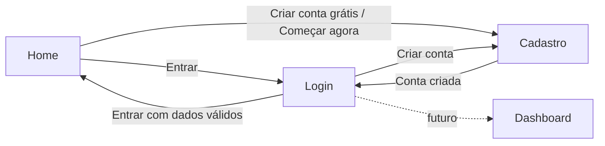

# 🎵 TrilhaSonora

> **Toda música guarda uma história.**

O **TrilhaSonora** é um projeto acadêmico que reúne as canções que marcaram vidas reais junto com os sentimentos e as memórias por trás delas. A ideia nasceu de uma pergunta simples: *se você tivesse que escolher uma música para resumir sua história, qual seria?*

O site funciona como um **fórum**, onde cada pessoa escolhe uma música, registra o sentimento que ela desperta e conta a lembrança que carrega. Reunidas em comunidade, essas histórias mostram o que a música guarda de nós.

Projeto desenvolvido no **1º semestre do curso de Ciência da Computação**, ligado ao trabalho de Pesquisa e Inovação sobre **música, lembranças e emoções**.

---

## 📑 Sumário

1. [Objetivos](#-objetivos)
2. [Telas e funcionalidades](#-telas-e-funcionalidades)
3. [Tecnologias utilizadas](#-tecnologias-utilizadas)
4. [Estrutura de pastas](#-estrutura-de-pastas)
5. [Fluxo de navegação](#-fluxo-de-navegação)
6. [Como executar](#-como-executar)
7. [Como o código funciona](#-como-o-código-funciona)
8. [Como adicionar uma nova história](#-como-adicionar-uma-nova-história)
9. [Identidade visual](#-identidade-visual)
10. [Conceitos de Algoritmos aplicados](#-conceitos-de-algoritmos-aplicados)
11. [Status do projeto](#-status-do-projeto)
12. [Limitações conhecidas](#-limitações-conhecidas)
13. [Direitos de imagem](#-direitos-de-imagem)
14. [Autoria](#-autoria)

---

## 🎯 Objetivos

**Objetivo geral:** criar uma plataforma onde as pessoas compartilhem músicas e as memórias ligadas a elas, mostrando a relação entre música, emoção e lembrança.

**Objetivos específicos:**

- Organizar cada memória por **sentimento** (Saudade, Alegria, Amor, Esperança, Nostalgia, Conforto, Tristeza e Energia).
- Dar destaque às **músicas e aos artistas** lembrados pela comunidade.
- Permitir **cadastro e login** de usuários.
- Preparar a base para uma **dashboard** com indicadores sobre os sentimentos mais publicados.
- Aplicar na prática os conceitos vistos em aula (HTML, CSS e JavaScript).

---

## 🖥️ Telas e funcionalidades

### 1. Home (`home.html`)

| Seção | O que faz |
|---|---|
| **Header fixo** | Menu no topo com o logo e os links Fórum, Dashboard, Perfil e **Entrar** (leva ao login). Acompanha a rolagem da página. |
| **Hero** | Frase de apresentação, botões *Criar conta grátis* e *Explorar o fórum* e os **chips** com as músicas recentes. |
| **Sobre o projeto** | Explica a proposta acadêmica e mostra números do projeto (histórias, sentimentos e artistas). |
| **Em destaque** | Mostra a história em destaque, com a capa do álbum, o nome da música, o artista, o sentimento (etiqueta), o relato e o autor. |
| **Histórias que tocaram a comunidade** | Cards com a capa do álbum, o sentimento, o título e quem contou a história. |
| **Navegue por sentimento** | Prateleiras coloridas, uma para cada um dos 8 sentimentos. |
| **Sentimentos mais publicados** | Ranking com barras de progresso dos 5 primeiros sentimentos. |
| **Artistas lembrados** | Círculos com a imagem e o nome de cada artista. |
| **Como participar** | Passo a passo em 3 etapas: escolher a música, registrar o sentimento e contar a história. |
| **Perguntas frequentes** | Perguntas e respostas em formato sanfona (abre e fecha ao clicar). |
| **Banner final** | Chamada para criar conta (*Começar agora*). |

### 2. Login (`login.html`)

- Campos de **e-mail** e **senha**.
- Botão de **mostrar/ocultar senha** (ícone de olho).
- Opção **Manter conectado** e link *Esqueceu sua senha?* (ainda sem função).
- Validações com mensagem de erro na tela:
  - campos vazios;
  - e-mail inválido (precisa ter `@` e `.`).
- Ao entrar com os dados válidos, redireciona para a Home (futuramente, para a dashboard).
- Link para o cadastro.

### 3. Cadastro (`cadastro.html`)

- Campos: **nome completo**, **e-mail**, **senha** e **confirmar senha**.
- Botão de mostrar/ocultar senha nos dois campos de senha.
- Validações com mensagem de erro na tela:
  - todos os campos preenchidos;
  - e-mail válido;
  - senha com **no mínimo 8 caracteres**;
  - senha com **pelo menos uma letra e um número** (conferido caractere por caractere com um `for`);
  - senha e confirmação **iguais**.
- Ao concluir, mostra a mensagem de sucesso e redireciona para o login.
- Link para o login.

---

## 🛠️ Tecnologias utilizadas

| Tecnologia | Uso |
|---|---|
| **HTML5** | Estrutura das páginas |
| **CSS3** | Estilo, layout responsivo, variáveis de cor e degradês |
| **JavaScript (puro)** | Montagem dinâmica da tela, validações e interações |
| **Google Fonts (Inter)** | Tipografia do site |

Não há frameworks nem bibliotecas externas, e o código segue o estilo trabalhado em aula (ids `ipt_`, funções simples, `if/else` e `for`).

---

## 📁 Estrutura de pastas

```text
TrilhaSonora/
├── home.html            # página inicial
├── login.html           # tela de login
├── cadastro.html        # tela de cadastro
├── css/
│   └── home.css         # estilos da Home
├── assets/              # capas dos álbuns e fotos
│   ├── esperando_na_janela.jpeg
│   ├── snowman.jpeg
│   ├── Exagero.jpeg
│   ├── me_libera.jpeg
│   ├── i_gotta_feeling.jpeg
│   └── less_than_zero.jpeg
└── README.md
```

> O `login.html` e o `cadastro.html` trazem o CSS dentro do próprio arquivo (tag `<style>`).

---

## 🧭 Fluxo de navegação



Hoje o login leva de volta à Home. Quando a dashboard existir, basta trocar o destino da função `entrar()` no `login.html`.

---

## ▶️ Como executar

O projeto é estático e não precisa de instalação.

**Opção 1: direto no navegador**

1. Baixe ou clone o repositório.
2. Dê dois cliques no `home.html`.

**Opção 2: com servidor local (recomendado)**

- No VS Code, instale a extensão **Live Server**, clique com o botão direito no `home.html` e escolha *Open with Live Server*.
- Ou, com Python instalado, rode na pasta do projeto:

```bash
python -m http.server 5500
```

Depois acesse `http://localhost:5500/home.html`.

**Requisitos:** um navegador atualizado e a conexão com a internet para carregar a fonte Inter. Sem internet, o site usa a fonte padrão do sistema.

---

## ⚙️ Como o código funciona

A Home foi escrita de forma simples. Os dados ficam em **vetores** no começo do `<script>`, e a tela é montada com **laços `for`**. Cada posição dos vetores é uma história, e todos seguem a **mesma ordem**.

### Vetores de dados

| Vetor | Conteúdo |
|---|---|
| `titulos` | Nome de cada música |
| `artistas` | Artista de cada música |
| `sentimentosHistoria` | Sentimento de cada história |
| `usuarios` | Quem contou a história |
| `datas` | Quando foi publicada (ex.: `há 10 d`) |
| `capas` | Caminho da capa do álbum (`./assets/...`) |
| `coresHistoria` | Cor de cada história (segue o sentimento) |
| `nomesSentimentos` / `coresSentimentos` | Os 8 sentimentos e suas cores |
| `nomesArtistas` | Nomes exibidos na seção de artistas |
| `perguntas` / `respostas` | Conteúdo do FAQ |

### Blocos de montagem da tela

Cada trecho percorre os vetores com um `for` e usa `innerHTML +=` com *template literals*:

| Elemento (`id`) | O que é montado |
|---|---|
| `chips` | Chips do topo, com a capa de cada música |
| `cards` | Cards das histórias, com a capa ao fundo e um escurecido para o texto ficar legível |
| `moods` | As 8 prateleiras de sentimento |
| `rank` | Ranking dos 5 primeiros sentimentos |
| `artists` | Círculos dos artistas (usam a capa do álbum; sem capa, mostram a inicial) |
| `faq` | Perguntas e respostas |

### Funções

| Função | Arquivo | O que faz |
|---|---|---|
| `abrirFechar(botao)` | `home.html` | Abre e fecha uma pergunta do FAQ (`classList.toggle('open')`) |
| `verSenha()` | `login.html`, `cadastro.html` | Alterna o campo de senha entre `password` e `text` |
| `verConfirmar()` | `cadastro.html` | Faz o mesmo para o campo de confirmação |
| `entrar()` | `login.html` | Valida os campos e redireciona |
| `cadastrar()` | `cadastro.html` | Valida todos os campos e redireciona para o login |

### Capas dos álbuns

Se uma posição do vetor `capas` for `''` (vazia), o site usa uma alternativa visual:

- **chips:** aparece a notinha musical;
- **cards:** aparece só a cor do sentimento;
- **artistas:** aparece a inicial do nome.

---

## ➕ Como adicionar uma nova história

1. Salve a capa do álbum na pasta `assets/`.
2. No `<script>` da `home.html`, adicione **um item no final de cada vetor**, mantendo a mesma ordem:

```js
titulos.push('Nome da música');
```

   Ou, de forma mais simples, edite os vetores e acrescente o novo valor no fim de `titulos`, `artistas`, `sentimentosHistoria`, `usuarios`, `datas`, `capas`, `coresHistoria` e `nomesArtistas`.

3. Use, em `coresHistoria`, a variável de cor do sentimento escolhido (ex.: `'var(--c-amor)'`).
4. Atualize os números da seção **Sobre o projeto**, se quiser.

> ⚠️ Se um vetor ficar com menos itens que os outros, aparecerá `undefined` na tela.

---

## 🎨 Identidade visual

- **Estilo:** tema escuro inspirado no Spotify, com detalhes em verde.
- **Logo:** "Trilha" em branco e "Sonora" em verde.
- **Fonte:** Inter (Google Fonts), pesos de 400 a 800.
- **Cores dos sentimentos:** cada sentimento tem uma variável CSS no `home.css`:

| Sentimento | Variável |
|---|---|
| Saudade | `--c-saudade` |
| Alegria | `--c-alegria` |
| Amor | `--c-amor` |
| Esperança | `--c-esperanca` |
| Nostalgia | `--c-nostalgia` |
| Conforto | `--c-conforto` |
| Tristeza | `--c-tristeza` |
| Energia | `--c-energia` |

- **Telas de login e cadastro:** fundo escuro com brilho verde no topo, card central e botão verde arredondado.

---

## 📚 Conceitos de Algoritmos aplicados

| Conceito | Onde aparece |
|---|---|
| **Variáveis** | `let` para ícones, textos, cores e valores digitados |
| **Vetores** | Todos os dados da Home (`titulos`, `capas`, `perguntas` etc.) |
| **Repetições** | `for` que monta chips, cards, sentimentos, ranking, artistas e FAQ; `for` que confere letras e números na senha |
| **Condicionais** | `if / else if / else` nas validações de login e cadastro e na escolha entre capa e alternativa visual |
| **Funções** | `abrirFechar`, `verSenha`, `verConfirmar`, `entrar`, `cadastrar` |
| **Comparações e operadores** | Tamanho da senha, `===`, `!==`, `&&` e `||` |

---

## 🚧 Status do projeto

**✅ Concluído**
- Home completa e interativa
- Telas de login e cadastro com validações
- Capas dos álbuns em chips, cards, artistas e destaque
- Header fixo

**🔄 Em andamento**
- Integração entre as telas e o fluxo de navegação

**📌 Planejado**
- Banco de dados próprio para guardar usuários e histórias
- Dashboard com indicadores (sentimentos mais publicados e outros dados)
- Página do fórum, com publicação de histórias
- Integração com a API do Spotify em partes do site (fora da dashboard)
- Recuperação de senha
- Páginas de Perfil e botão Sair

---

## ⚠️ Limitações conhecidas

- **Login e cadastro são apenas visuais:** nenhum dado é salvo nem conferido, porque ainda não há banco de dados.
- **Os dados da Home são fixos:** vêm dos vetores do código, não de um servidor.
- **"Fórum", "Dashboard" e "Perfil" no menu** levam a seções da própria Home por enquanto.
- **O link "Esqueceu sua senha?"** ainda não tem função.
- As imagens da pasta `assets/` precisam estar com os **mesmos nomes** usados no vetor `capas`; caso contrário, a imagem aparece quebrada.
- O número de histórias, sentimentos e artistas na seção "Sobre o projeto" é digitado à mão.

---

## 🖼️ Direitos de imagem

As capas de álbum e fotos usadas pertencem aos seus respectivos artistas, gravadoras e fotógrafos, e aparecem aqui apenas para **fins acadêmicos e ilustrativos**. As histórias e os nomes de usuários exibidos na Home são **exemplos fictícios**.

---

## 👥 Autoria

Projeto acadêmico de Ciência da Computação (1º semestre).

- **Julio Lino**

---

<p align="center">Feito com 🎧 e muitas memórias.</p>
